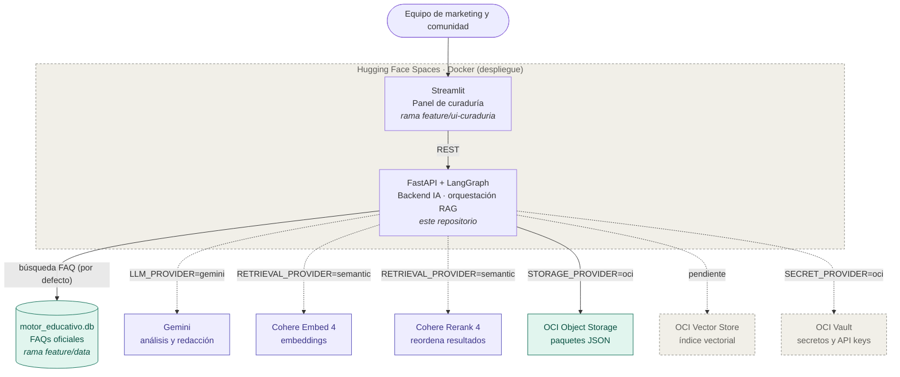
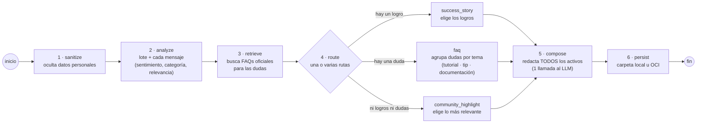

# G10-LATAM-equipo-25 · CommunityLab

Solución inteligente y automatizada capaz de ingerir la actividad orgánica de una comunidad digital (mensajes, debates en foros, feedback de cursos, entregas de proyectos de estudiantes, interacciones en chats), analizar estos datos y convertirlos automáticamente en activos de distribución listos para su publicación y toma de decisiones.

**Enfoque del equipo:** Motor de FAQ dinámico y contenido educativo. Las dudas frecuentes de los estudiantes se agrupan por tema y, para cada tema, Gemini redacta un **tutorial rápido**, un **tip de la semana** y una **propuesta de tema de documentación**, apoyados en las FAQs oficiales de `motor_educativo.db`. Lo que se aprueba sin respaldo oficial se agrega a la base, así el motor aprende de la comunidad. Los logros y la actividad general se convierten en publicaciones para LinkedIn y la newsletter.

Hackathon ONE G10 · Oracle Next Education & Alura · Equipo 25

---

## Contenido

1. [Qué hace](#qué-hace)
2. [Arquitectura](#arquitectura)
3. [Cómo decide el motor (flujo LangGraph)](#cómo-decide-el-motor-flujo-langgraph)
4. [Puesta en marcha paso a paso](#puesta-en-marcha-paso-a-paso)
5. [Demostración con los lotes de ejemplo](#demostración-con-los-lotes-de-ejemplo)
6. [API](#api)
7. [Configuración](#configuración)
8. [Estructura del repositorio](#estructura-del-repositorio)
9. [Checklist del hackathon](#checklist-del-hackathon)
10. [Documentación detallada](#documentación-detallada)

---

## Qué hace

1. **Recibe** un lote de mensajes de la comunidad (JSON con el formato del briefing o CSV).
2. **Oculta los datos personales** (correos, teléfonos, enlaces, IPs y menciones) antes de que el texto llegue a cualquier servicio de IA.
3. **Analiza** el lote y **cada mensaje**: sentimiento general y temas del lote; y por mensaje, su sentimiento, su categoría (logro, duda, pedido de apoyo o comentario), si la persona necesita apoyo y un **puntaje de relevancia** de 0 a 1 para elegir los mejores momentos.
4. **Busca la respuesta oficial** de las dudas en las FAQs de `motor_educativo.db`.
5. **Decide las rutas** (pueden ser varias a la vez) y genera los borradores de todas ellas:

   | Si el lote trae... | Ruta | Activos generados |
   |---|---|---|
   | Al menos un logro o testimonio | `success_story` | Historia de éxito + Post de LinkedIn |
   | Al menos una duda o pregunta | `faq` (Motor de FAQ dinámico) | Por cada tema de dudas (hasta 2 por lote): **tutorial rápido**, **tip de la semana** y **tema de documentación**, con la FAQ oficial del tema |
   | Ni logros ni dudas (actividad general) | `community_highlight` | Post de LinkedIn + Resumen para newsletter |

   Un lote con un logro **y** una duda activa las dos primeras rutas y genera los **4 activos**, como en el ejemplo de salida del briefing. Ningún mensaje importante se pierde.
6. **Guarda** el paquete (análisis, evidencia y borradores) en una carpeta local o en **OCI Object Storage**.
7. Una persona **revisa, edita y aprueba** los borradores en el panel de curaduría (Streamlit). Nada se publica sin revisión humana.

## Arquitectura



| Capa | Elección | Estado |
|---|---|---|
| LLM | Gemini (modelo configurable; probado con `gemini-3.1-flash-lite`) | Implementado y probado con Gemini real. Sin clave se usan reglas locales (`mock`) |
| Búsqueda de FAQs | BM25 sobre `motor_educativo.db` | Implementado, **por defecto**, sin claves |
| Embeddings + Reranker | Cohere Embed 4 + Rerank 4 | Implementado y probado con Cohere real (`RETRIEVAL_PROVIDER=semantic`); entiende dudas escritas sin palabras clave. Ver [comparación](docs/busqueda-semantica.md) |
| Orquestación | LangGraph | Implementado |
| Backend IA | Python + FastAPI | Implementado |
| Almacenamiento de paquetes | OCI Object Storage (Always Free) | Implementado (`STORAGE_PROVIDER=oci`). Falta probar con el bucket real |
| UI | Streamlit | Implementado (rama `feature/ui-curaduria`) |
| Vector store | OCI Generative AI Vector Stores | Pendiente. Hoy el índice vectorial es un archivo JSON local |
| Secretos | OCI Vault | Implementado (`SECRET_PROVIDER=oci`). Falta probar con una cuenta real; por defecto se usa el `.env` |
| Hosting | Hugging Face Spaces (Docker) | Listo para publicar con [docs/despliegue-hugging-face.md](docs/despliegue-hugging-face.md). La memoria del motor (`STATE_PROVIDER=oci`) y las claves viven en OCI; el servidor solo ejecuta |

El backend sigue una **arquitectura hexagonal**: el dominio define contratos (*puertos*) y cada proveedor externo es un *adaptador* intercambiable. Por eso cada pieza tiene un modo local que no necesita claves, y se cambia a Gemini, Cohere u OCI con una variable de entorno, sin tocar el flujo.

## Cómo decide el motor (flujo LangGraph)



- **Varias rutas por lote.** `route` activa `success_story` si hay algún logro, `faq` si hay alguna duda, y `community_highlight` solo si no hay ninguna de las dos. Las ramas activas corren **en paralelo**. Con el ejemplo del briefing (un logro y una duda) se generan historia de éxito, post de LinkedIn, FAQ y destacado de newsletter.
- **Las ramas no escriben, eligen.** Cada rama arma un *encargo* (qué mensajes, qué FAQs oficiales y qué activos pedir). El nodo `compose` redacta todos los encargos juntos con **una sola llamada** al modelo, para cuidar la cuota gratuita de Gemini (2 llamadas por lote en total).
- **Puntaje de relevancia.** Cada mensaje recibe un puntaje de 0 a 1. Con él se eligen los mensajes de cada encargo, los 3 mejores momentos del lote y se avisa qué mensajes quedaron fuera (`discarded`).
- Cada borrador sale en estado `draft` y el paquete queda con `human_review: pending`.
- El autor y la fecha de cada mensaje nunca entran al grafo: no llegan a Gemini ni a Cohere. El autor solo se une a la respuesta al final, para decir quién logró un hito o quién necesita apoyo.

## Puesta en marcha paso a paso

Requisitos: **Python 3.13 o superior** y Git.

> Guía completa para instalar desde cero, cambiar las credenciales (Gemini, Cohere, OCI) y resolver problemas comunes: **[docs/instalacion.md](docs/instalacion.md)**.

### 1. Backend (esta rama)

Desde la raíz del repositorio:

```bash
python -m venv .venv
# Windows (PowerShell):  .venv\Scripts\activate
# macOS / Linux:         source .venv/bin/activate

pip install -r communitylab_backend/requirements.txt

# Windows:  copy .env.example .env
cp .env.example .env

uvicorn communitylab_backend.main:app --reload
```

- La API queda en `http://localhost:8000`.
- La documentación interactiva queda en `http://localhost:8000/docs`, donde se puede probar cada endpoint desde el navegador.
- **No hace falta llenar el `.env`**: sin claves funciona en modo local, con reglas locales para el análisis, la base de FAQs y una carpeta para los paquetes.

### 2. Panel de curaduría (rama `feature/ui-curaduria`)

El panel vive en otra rama. Con el backend encendido, en otra terminal:

```bash
cd communitylab_ui            # dentro de la carpeta de la rama feature/ui-curaduria
pip install -r requirements.txt
streamlit run ui/app.py
```

Se abre en `http://localhost:8501`. Su README explica cada vista.

### 3. Activar los servicios reales (opcional)

| Para usar... | En el `.env` | Guía |
|---|---|---|
| Gemini | `LLM_PROVIDER=gemini` y `GEMINI_API_KEY` | [docs/adaptadores-cohere-gemini.md](docs/adaptadores-cohere-gemini.md) |
| Búsqueda semántica | `RETRIEVAL_PROVIDER=semantic`, `EMBEDDING_PROVIDER=cohere`, `RERANKER_PROVIDER=cohere`, `COHERE_API_KEY` | [docs/busqueda-semantica.md](docs/busqueda-semantica.md) |
| OCI Object Storage | `STORAGE_PROVIDER=oci`, `OCI_NAMESPACE`, `OCI_BUCKET`, `OCI_REGION` | [docs/object-storage-oci.md](docs/object-storage-oci.md) |
| Claves desde OCI Vault (producción) | `SECRET_PROVIDER=oci`, `OCI_VAULT_ID`, `OCI_AUTH=instance_principal` | [docs/secretos.md](docs/secretos.md) |

## Demostración con los lotes de ejemplo

La carpeta [`ejemplos/`](ejemplos) trae 7 lotes que recorren las tres rutas. Las respuestas en modo local están en `salidas/respuestas/` y las generadas con **Gemini real**, en `salidas/respuestas_gemini/`:

| Archivo | Qué simula | Rutas esperadas | Activos |
|---|---|---|---|
| `01_briefing_semana04.json` | El ejemplo exacto del briefing (logro + duda) | `success_story` + `faq` | Historia de éxito, LinkedIn, y tutorial + tip + tema de documentación sobre LangGraph |
| `02_dudas_machine_learning.json` | Tres dudas sobre sobreajuste, incluye un correo que se oculta | `faq` | Tutorial, tip y tema de documentación por tema |
| `03_dudas_datos_nlp.json` | Dudas sobre datos faltantes | `faq` | Tutorial, tip y tema de documentación por tema |
| `04_actividad_general.json` | Anuncios y comentarios sin dudas | `community_highlight` (con Gemini puede ser `success_story`: toma como logro a quien compartió su notebook terminado) | LinkedIn y newsletter |
| `05_formulario_dudas.csv` | Export CSV de un formulario, incluye un teléfono que se oculta. Un comentario que pide apoyo queda fuera de la FAQ (`discarded`) | `faq` | Tutorial, tip y tema de documentación por tema |
| `06_resenas_reales_coursera.json` | 10 reseñas **reales** de cursos tomadas de `motor_educativo.db` (en inglés): un certificado terminado, dudas técnicas, quejas y elogios. Sirve para probar con datos reales; con Gemini se aprovecha mejor, porque las reglas del modo local están pensadas para mensajes en español | `faq` | Tutorial, tip y tema de documentación por cada uno de sus 2 temas principales |
| `07_dudas_semana06.json` | La semana siguiente: vuelven a preguntar por LangGraph, sobreajuste y datos faltantes. Muestra el ranking de **dudas frecuentes** (mismo tema en 2 lotes) y la duda repetida que no tiene FAQ oficial | `faq` | Tutorial, tip y tema de documentación por tema |

Procesarlos todos desde la terminal, sin levantar la API:

```bash
python -m communitylab_backend.tools.process_batch ejemplos
```

Cada respuesta queda en [`salidas/respuestas/`](salidas/respuestas) (entrada + respuesta completa) y cada paquete en `salidas/paquetes/` o en el bucket de OCI. Las respuestas que ya están en el repositorio se generaron en modo local y sirven como evidencia de la demostración.

El guion completo para presentar está en [docs/guia-demo.md](docs/guia-demo.md).

## API

| Método | Ruta | Para qué |
|---|---|---|
| `GET` | `/health` | Saber si la API está encendida |
| `GET` | `/api/v1/status` | Ver qué LLM, buscador y almacenamiento están activos (sin mostrar claves) |
| `POST` | `/api/v1/activity/process` | Procesar un lote y obtener análisis (del lote y de cada mensaje), rutas, evidencia y borradores |
| `POST` | `/api/v1/rag/query` | Buscar FAQs oficiales para una pregunta |
| `POST` | `/api/v1/assets/review` | Guardar lo que se aprobó o rechazó en el panel |
| `GET` | `/api/v1/knowledge/summary` · `/faqs` · `/reviews` | Ver qué hay en `motor_educativo.db`: totales, FAQs oficiales y reseñas reales |
| `POST` | `/api/v1/knowledge/faqs/import` | Agregar FAQs nuevas a la base (primero vista previa; copia de seguridad antes de escribir) |
| `GET` | `/api/v1/knowledge/frequent-doubts` | Ranking de dudas frecuentes del historial (temas, cantidad, semanas y si tienen FAQ oficial). Sin IA |

`/api/v1/activity/process` acepta los nombres del briefing en español (`origen_comunidad`, `periodo_referencia`, `interacciones` con `autor`, `canal`, `tipo`, `texto`) y también sus equivalentes en inglés.

```bash
curl -X POST http://localhost:8000/api/v1/activity/process \
     -H "Content-Type: application/json" \
     -d @ejemplos/02_dudas_machine_learning.json
```

### Ejemplo de respuesta

Respuesta real (modo local) para `ejemplos/01_briefing_semana04.json`, con los textos largos recortados (`…`):

```json
{
  "status": "success",
  "request_id": "<uuid del procesamiento>",
  "community_summary": {"total_interactions_processed": 2, "predominant_sentiment": "positive", "main_topics": ["Empleo y logros", "IA generativa y LangGraph", "Oracle Cloud (OCI)", "Comunidad"]},
  "routing": {
    "selected_flow": "success_story",
    "flows": ["success_story", "faq"],
    "reasons": {"success_story": "Señal de historia de éxito: 1 logro(s) o testimonio(s)", "faq": "Señal de pregunta recurrente: 1 duda(s) de la comunidad"}
  },
  "generated_assets": [
    {"kind": "success_story", "flow": "success_story", "title": "Historia de éxito de la comunidad", "body": "…", "status": "draft", "evidence_ids": []},
    {"kind": "linkedin_post", "flow": "success_story", "title": "De la comunidad al mercado", "body": "…", "status": "draft", "evidence_ids": []},
    {"kind": "quick_tutorial", "flow": "faq", "topic": "IA generativa y LangGraph", "title": "Tutorial rápido: IA generativa y LangGraph", "body": "…", "status": "draft", "evidence_ids": []},
    {"kind": "weekly_tip", "flow": "faq", "topic": "IA generativa y LangGraph", "title": "Tip de la semana: IA generativa y LangGraph", "body": "…", "status": "draft", "evidence_ids": []},
    {"kind": "doc_topic", "flow": "faq", "topic": "IA generativa y LangGraph", "title": "Tema de documentación: IA generativa y LangGraph", "body": "…", "status": "draft", "evidence_ids": []}
  ],
  "interaction_analysis": [
    {"id": "interaction-1", "author": "Mariana Souza", "channel": "#logros-y-empleos", "text": "Comunidad, quede seleccionada…", "sentiment": "positive", "category": "logro", "relevance": 0.89, "needs_support": false},
    {"id": "interaction-2", "author": "Lucas Albuquerque", "channel": "#dudas-langgraph", "text": "Tengo dudas sobre como estructurar…", "sentiment": "neutral", "category": "duda", "relevance": 0.71, "needs_support": true}
  ],
  "highlights": ["interaction-1", "interaction-2"],
  "members_needing_support": [{"id": "interaction-2", "author": "Lucas Albuquerque", "channel": "#dudas-langgraph", "category": "duda"}],
  "discarded": [],
  "human_review": {"required": true, "status": "pending"},
  "storage": {"provider": "local", "status": "stored", "location": "salidas/paquetes/<request_id>.json"},
  "evidence": [],
  "formato_briefing": {
    "status": "exito",
    "resumen_comunidad": {"total_interacciones_procesadas": 2, "sentimiento_predominante": "Positivo", "temas_principales": ["Empleo y logros", "IA generativa y LangGraph", "Oracle Cloud (OCI)", "Comunidad"]},
    "activos_distribucion_generados": {
      "post_linkedin": {"titulo": "De la comunidad al mercado", "copy": "…", "canal_recomendado": "LinkedIn Oficial", "potencial_engagement": "Alto"},
      "destaque_newsletter_semanal": {"seccion": "Dudas de la Semana", "titular": "Dudas de la semana", "resumen": "…"},
      "sugerencia_contenido_faq": {"tema": "Duda de la semana: IA generativa y LangGraph", "origen": "Duda planteada por Lucas Albuquerque en #dudas-langgraph", "status": "derivado_a_mentoria"},
      "caso_exito": {"titulo": "Historia de éxito de la comunidad", "origen": "Logro compartido por Mariana Souza en #logros-y-empleos", "borrador": "…", "status": "validar_con_la_persona"}
    },
    "almacenamiento_oci": {"bucket": null, "ruta_objeto": "salidas/paquetes/<request_id>.json", "status": "guardado_local"}
  },
  "warnings": []
}
```

Qué significa cada bloque nuevo:

| Campo | Para qué sirve |
|---|---|
| `routing.flows` / `routing.reasons` | Todas las rutas que activó el lote y por qué. `selected_flow` sigue indicando la principal |
| `generated_assets[].flow` | Qué ruta encargó cada activo |
| `interaction_analysis` | Texto con los datos personales ya ocultos (`text`), sentimiento, categoría (`logro`, `duda`, `apoyo`, `comentario`), relevancia (0 a 1) y si necesita apoyo, por mensaje |
| `highlights` | Los 3 mensajes más relevantes: los "mejores momentos" de la semana |
| `members_needing_support` | Quién necesita respuesta o mentoría |
| `discarded` | Mensajes que no entraron a ningún activo |
| `formato_briefing` | La misma información con la estructura exacta del ejemplo de salida del briefing. `sentimiento_predominante` es "Altamente Positivo" cuando el lote es positivo y al menos el 75% de sus mensajes también; `potencial_engagement` sale de la relevancia máxima (Alto ≥ 0.8, Medio ≥ 0.5); la FAQ queda `respuesta_con_faq_oficial` si cita una FAQ o `derivado_a_mentoria` si no. Con OCI, `almacenamiento_oci` trae el bucket real y `guardado_con_exito` |

Errores: `422` si el lote es inválido, `502` si falla la búsqueda, la generación o el almacenamiento, y `503` si un proveedor configurado no está disponible. Los mensajes nunca incluyen claves ni el texto de los mensajes.

## Configuración

Todas las variables están explicadas en [`.env.example`](.env.example). Las principales:

| Variable | Valores | Por defecto |
|---|---|---|
| `LLM_PROVIDER` | `mock`, `gemini` | `mock` |
| `RETRIEVAL_PROVIDER` | `faq_db`, `semantic`, `mock` | `faq_db` |
| `FAQ_DB_PATH` | Ruta de la base de FAQs | `data/motor_educativo.db` |
| `HISTORY_DB_PATH` | Historial local de dudas (ranking de frecuentes) | `data/historial_dudas.db` |
| `FAQ_BACKUP_DIR` | Copias de seguridad de la base al agregar FAQs | `data/respaldos` |
| `RETRIEVAL_MIN_SCORE` | Relevancia mínima (0 a 1) para aceptar una FAQ en la búsqueda semántica | `0.5` |
| `STORAGE_PROVIDER` | `local`, `oci` | `local` |
| `LOCAL_STORAGE_DIR` | Carpeta de paquetes en modo local | `salidas/paquetes` |
| `SECRET_PROVIDER` | `environment` (claves del `.env`), `oci` (claves de OCI Vault) | `environment` |

**Nunca subas el `.env`, `~/.oci/config` ni las claves `.pem` al repositorio.** Cómo manejar las claves en tu computadora y en producción: [docs/secretos.md](docs/secretos.md).

## Estructura del repositorio

```
.
├── communitylab_backend/        Código del backend
│   ├── api/                     Entrada HTTP: esquemas y composición de adaptadores
│   ├── application/             Casos de uso: grafo LangGraph, ingesta, lotes, base de conocimiento, búsqueda semántica
│   ├── domain/                  Modelos, contratos (puertos) y errores
│   ├── infrastructure/          Adaptadores: Gemini, Cohere, OCI, base de FAQs, datos personales, modo local
│   ├── tools/                   Herramientas de terminal (lotes, índice FAQ, prueba de OCI)
│   ├── config/                  Variables de entorno
│   └── main.py                  Aplicación FastAPI
├── data/motor_educativo.db      Base de FAQs y reseñas (entregada por la rama feature/data)
├── ejemplos/                    Lotes de demostración (JSON y CSV)
├── salidas/respuestas/          Resultados de la demostración
├── docs/                        Documentación por tema
├── despliegue/huggingface/      Dockerfile y arranque para Hugging Face Spaces
├── tests/backend/               Pruebas unitarias
└── .env.example                 Plantilla de configuración
```

## Checklist del hackathon

| Requisito | Dónde se cumple |
|---|---|
| Ingesta funcional de interacciones (JSON, CSV) | `POST /api/v1/activity/process`, `application/ingestion.py`, pestañas del panel |
| Sentimiento y temas con LLM | Nodo `analyze` con `GeminiLLMAdapter` (`LLM_PROVIDER=gemini`), por lote y por mensaje |
| Quién logró un hito y quién necesita apoyo | `interaction_analysis` y `members_needing_support` en la respuesta |
| Puntaje de relevancia para elegir los mejores momentos | `relevance` por mensaje y `highlights` (3 mejores) |
| Al menos 2 formatos de activos | Hasta 7 formatos: tutorial rápido, tip de la semana, tema de documentación, historia de éxito, LinkedIn y newsletter |
| Foco del equipo: dudas frecuentes → tutoriales, tips y documentación | Rama `faq` agrupada por tema, historial y ranking de dudas frecuentes (`GET /api/v1/knowledge/frequent-doubts`), y FAQs nuevas desde la curaduría |
| Orquestación con bifurcación de condiciones | Grafo LangGraph: `route` activa una o varias ramas en paralelo y `compose` las reúne (`application/orchestration.py`) |
| Salida con el formato del briefing | Campo `formato_briefing` (`application/briefing_format.py`) |
| Integración con OCI Object Storage | `infrastructure/oci_storage.py` (`STORAGE_PROVIDER=oci`) |
| Mínimo 3 ejemplos de transformación | `ejemplos/` → `salidas/respuestas/` (5 lotes, 3 rutas) |
| Repositorio documentado con diagrama | Este README y la carpeta `docs/` |
| Interfaz de curaduría (diferencial) | Rama `feature/ui-curaduria` (Streamlit) |

## Documentación detallada

| Documento | Tema |
|---|---|
| [docs/integracion-ramas.md](docs/integracion-ramas.md) | **Qué se integró de cada rama, qué se cambió y por qué**, y las mejoras posteriores (varias rutas por lote, análisis por mensaje, formato del briefing, claves desde OCI Vault) |
| [docs/instalacion.md](docs/instalacion.md) | **Instalación paso a paso y cambio de credenciales**, en lenguaje simple |
| [docs/despliegue-hugging-face.md](docs/despliegue-hugging-face.md) | **Publicar el proyecto en Hugging Face Spaces** con OCI Object Storage y OCI Vault |
| [docs/registro-de-funciones.md](docs/registro-de-funciones.md) | **Para qué sirve cada función que cambió y por qué**, y cómo se respeta la arquitectura hexagonal |
| [docs/motor-faq-base-de-datos.md](docs/motor-faq-base-de-datos.md) | Cómo se buscan las FAQs en `motor_educativo.db` |
| [docs/guia-demo.md](docs/guia-demo.md) | Guion paso a paso para la demostración |
| [docs/adaptadores-cohere-gemini.md](docs/adaptadores-cohere-gemini.md) | Adaptadores de Gemini y Cohere |
| [docs/busqueda-semantica.md](docs/busqueda-semantica.md) | Búsqueda semántica con Cohere (Embed + Rerank) |
| [docs/object-storage-oci.md](docs/object-storage-oci.md) | Almacenamiento en OCI Object Storage |
| [docs/secretos.md](docs/secretos.md) | **Manejo de claves**: `.env` local, OCI Vault en producción y rotación |

## Pruebas

```bash
pip install -r communitylab_backend/requirements-dev.txt
python -m pytest tests/backend -q
python -m communitylab_backend.documentation_check
```

Las pruebas usan clientes falsos: no gastan cuota de Gemini, Cohere ni OCI.
