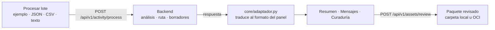

# CommunityLab — Panel de curaduría

Panel donde el equipo de marketing envía lotes de mensajes de la comunidad al motor, revisa lo que generó y decide qué se publica.
Hackathon ONE G10 · Equipo 25 · Enfoque: Motor de FAQ dinámico y contenido educativo.

Los cambios que conectaron este panel con el backend, y el motivo de cada uno, están en [`../docs/integracion-con-backend.md`](../docs/integracion-con-backend.md).

---

## Qué hace

| Vista | Para qué sirve |
|---|---|
| **Procesar lote** | Enviar mensajes al motor: lotes de ejemplo, un archivo JSON o CSV, mensajes escritos a mano o respuestas guardadas |
| **Resumen** | Interacciones, sentimiento, temas y la **ruta que eligió el motor para cada lote** (FAQ, historia de éxito o resumen) |
| **Mensajes procesados** | Cada mensaje que entró, su lote y su ruta. Los datos personales aparecen ocultos (`[EMAIL]`, `[TELEFONO]`) |
| **Curaduría de activos** | Una **bandeja**: a la izquierda la lista de borradores (filtrable por estado, tipo y lote); a la derecha el borrador abierto con su **vista previa por canal** (LinkedIn, newsletter, FAQ, historia de éxito), el editor con contador de caracteres y los mensajes y la FAQ oficial que lo respaldan. Al aprobar o rechazar se abre el siguiente pendiente. Se guarda la decisión en el backend y se exportan los aprobados en JSON o Markdown |
| **Configuración** | Dónde se guardan los paquetes (carpeta local u OCI Object Storage), qué modelo usa el motor y qué secretos faltan |

Nada se publica automáticamente: el panel solo registra qué se aprobó.

---

## Cómo ejecutarlo

El panel necesita el **backend encendido** (rama `feature/backend-ia-orchestration`, ver su README). Guía paso a paso en lenguaje simple: [docs/panel-instalacion.md](../docs/panel-instalacion.md). Para qué sirve cada función y por qué cambió: [docs/panel-registro-de-funciones.md](../docs/panel-registro-de-funciones.md).

Con el backend en `http://localhost:8000`:

```bash
cd communitylab_ui

python -m venv .venv
# Windows:       .venv\Scripts\activate
# macOS/Linux:   source .venv/bin/activate

pip install -r requirements.txt

# Windows:  copy .env.example .env
cp .env.example .env

streamlit run ui/app.py
```

Se abre en `http://localhost:8501`.

- Si el backend está en otra dirección, cámbiala en `BACKEND_URL` dentro del `.env`.
- **Sin backend** el panel abre igual y muestra un aviso. Desde *Procesar lote → Respuesta guardada* se pueden cargar los archivos de `salidas/respuestas/` del backend para ver resultados reales.

---

## Cómo fluyen los datos



1. El panel envía el lote con el formato del briefing (`origen_comunidad`, `periodo_referencia`, `interacciones`).
2. El backend responde con el análisis, la ruta elegida, las citas de la FAQ oficial y los borradores.
3. Cada respuesta se guarda en la sesión como una **corrida**. El adaptador junta todas las corridas para las vistas.
4. Al guardar la curaduría, el backend almacena la versión revisada junto al borrador original.

---

## Estructura

```
communitylab_ui/
├── data/
│   └── lotes_ejemplo/          Los mismos 5 lotes de ejemplo del backend
├── ui/
│   ├── app.py                  Lógica: vistas, estado, aprobar/rechazar
│   ├── mui_blocks.py           Dibujo con Material UI (streamlit-mui-elements)
│   ├── previas.py              Vista previa de cada activo en su canal (HTML simple)
│   └── theme.py                Colores y CSS
├── core/
│   ├── backend.py              Único punto que llama al backend por HTTP
│   ├── adaptador.py            Respuesta del backend → datos del panel
│   ├── ingesta.py              Lectura de JSON/CSV y lotes de ejemplo
│   └── secretos.py             Lectura de variables y secretos
├── .env.example
├── .gitignore
└── requirements.txt
```

---

## El contrato de datos

El formato de entrada es el del briefing. El de salida lo define el backend y se puede consultar en `http://localhost:8000/docs`.

**Regla del equipo:** si el backend cambia el nombre de un campo, se ajusta **solo** `core/adaptador.py`. Las vistas no se tocan. Esta regla la cumplía antes `data/resultados_ejemplo.json`, que se retiró al conectar el backend real.

Formato del CSV aceptado:

```csv
autor,canal,tipo,texto
Estudiante_H,Formulario de feedback,pregunta,¿Cuál es la diferencia entre clasificación y regresión?
```

Solo la columna `texto` es obligatoria. Tipos que reconoce el motor: `pregunta_tecnica`, `pregunta`, `duda` (ruta FAQ), `testimonio`, `logro` (ruta historia de éxito) y cualquier otro (resumen de comunidad).

---

## Secretos

### Hoy: archivo `.env`

Todo el equipo usa la misma función y no le importa de dónde sale el valor:

```python
from core.secretos import obtener_secreto

clave = obtener_secreto("GEMINI_API_KEY")
```

Verificar el entorno propio:

```bash
python core/secretos.py
```

Las claves de Gemini, Cohere y OCI las usa el **backend**, en su propio `.env`. La vista **Configuración** muestra qué proveedores tiene activos el backend, sin mostrar las claves.

### Producción: OCI Vault

`_leer_de_vault()` en `core/secretos.py` ya lee de OCI Vault. Para usarlo basta con cambiar variables de entorno (ver `.env.example`):

```
FUENTE_SECRETOS=vault        # o auto: intenta el Vault y, si falla, usa el .env
OCI_VAULT_ID=ocid1.vault...
OCI_AUTH=instance_principal  # en OCI Compute; config para probar desde una computadora
```

Ningún otro archivo del proyecto cambia. El SDK de OCI (`oci`) viene en `requirements.txt`; si faltara, el panel arranca igual y solo avisa al intentar leer el Vault. La plantilla `.env.example` trae `FUENTE_SECRETOS=auto`: sin `OCI_VAULT_ID` (o `OCI_VAULT_OCID`) usa el `.env` sin avisos. El nombre de cada secreto en el Vault está en `CATALOGO_SECRETOS` (por ejemplo `communitylab-gemini-api-key`), igual que en el backend. Cómo crear el Vault, la política y rotar claves: `docs/secretos.md` del backend.

**Sobre el costo:** OCI Vault entra en Always Free (hasta 20 versiones de claves maestras y 150 secretos). Hay que usar el **Virtual Vault**, que es el tipo por defecto, con **clave de software**. El Private Vault y las claves HSM dedicadas sí tienen costo. Verificar los límites vigentes de Always Free antes de crear nada.

### Reglas innegociables

1. `.env` **nunca** se sube. Ya está en `.gitignore`.
2. `.env.example` sí se sube, con nombres de variables y sin valores.
3. Si alguien sube una clave por error, hay que **rotarla**. Borrarla del repositorio no la borra del historial de Git.

---

## Estado frente al checklist de evaluación

| Requisito | Estado |
|---|---|
| Ingesta funcional | Listo: lotes de ejemplo, JSON, CSV y texto libre |
| Análisis con LLM | Listo en el backend (Gemini con `LLM_PROVIDER=gemini`; modo local sin clave) |
| ≥ 2 formatos de activo | Listo: FAQ, newsletter, LinkedIn e historia de éxito |
| Orquestación con bifurcación | Listo: tabla "Decisiones del motor por lote" en Resumen |
| OCI Object Storage | Implementado en el backend; visible en Configuración. Falta probar con el bucket real |
| 3 ejemplos demostrados | Listo: 5 lotes de ejemplo, 3 rutas |
| Panel de curaduría (diferencial) | Listo: editar, aprobar, rechazar y guardar |
